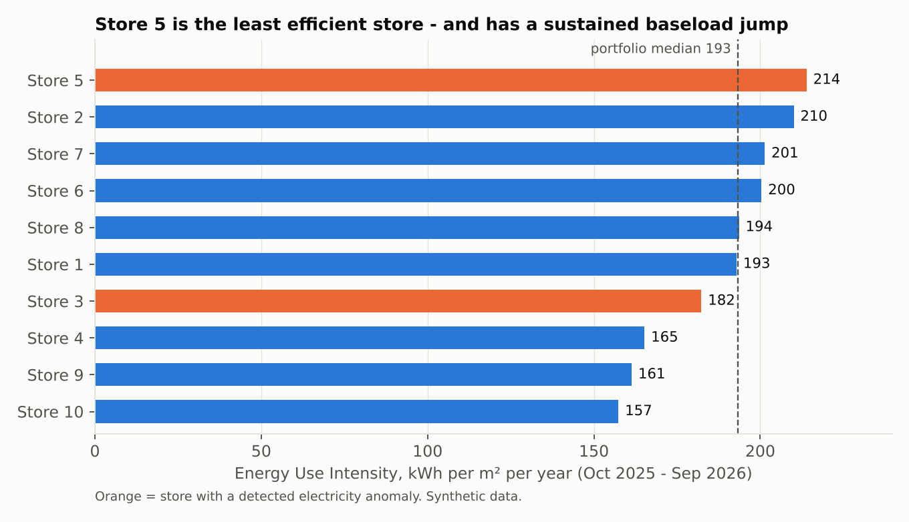
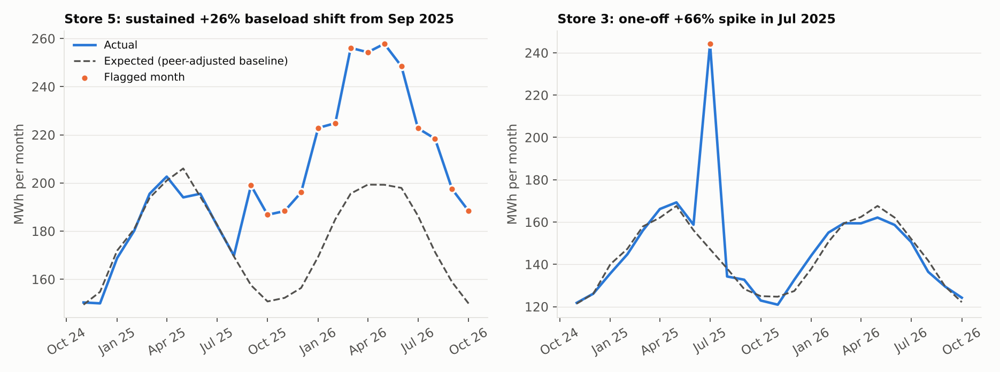
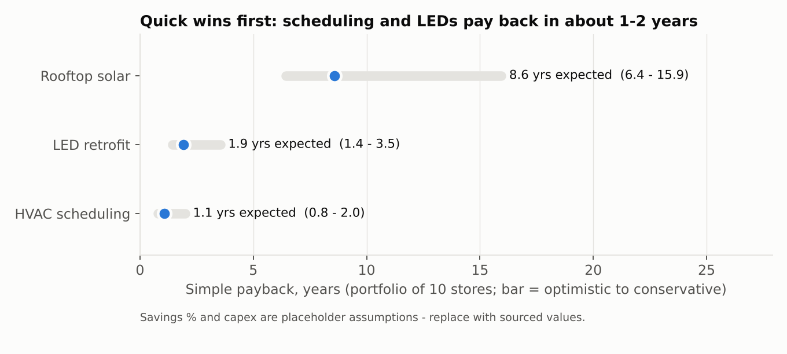

# Retail Store Energy Intelligence (RSEI)

**Anomaly detection, store benchmarking and savings analysis for a 10-store retail portfolio.**
MySQL + Python + Power BI. Built to mirror the day-to-day of an energy analyst: validate utility data,
find waste, benchmark sites, convert to carbon, and put a rupee value and payback on the fixes.

> **The data is synthetic.** Real store-level utility data is not public, so `load_energy_data.py`
> generates 10 stores x 24 months (Nov 2024 - Oct 2026) of electricity, water and diesel bills with
> *deliberately injected* problems. That lets the detection be checked against a known answer key.
> The grid emission factor is sourced from CEA; diesel and savings assumptions are placeholders (see [Assumptions](#assumptions-and-limits)).

## Headline findings (Oct 2025 - Sep 2026)

| Portfolio | |
|---|---|
| Electricity | 19.6 GWh |
| Electricity cost | ₹18.0 crore |
| Carbon (electricity + diesel) | 14,294 tCO2e |
| Median Energy Use Intensity (EUI) | 193 kWh/m2/year |

* **Store 5 has a sustained baseload jump** from Sep 2025: about **+26%** above its peer-adjusted baseline for
  14 months running, roughly **6.3 lakh kWh / ₹55 lakh** of excess so far. It is also the least efficient store
  (EUI 214, 11% above the median). Fixing it is the biggest single saving: **~5.4 lakh kWh, ₹47.7 lakh and
  396 tCO2e per year** with no capex assumed (an operational fix: schedules, HVAC setpoints, lights left on).
* **Store 3** had a one-off **+66% electricity spike in Jul 2025** (about ₹9.3 lakh excess).
* **Store 8** had a **diesel surge in Jun 2025** (about 1,680 L, ₹1.5 lakh at an assumed ₹90/L), consistent with a power cut and generator use.
* **Store 6** had a **water spike in Oct 2025** (about 580 kL above normal), consistent with a leak.
* Data-quality issues found and handled: a duplicate bill (Store 2, May 2025), a missing month (Store 7, Mar 2025) and a missing reading (Store 9, Jan 2026).
* Flagged anomalies total roughly **₹66 lakh** of avoidable cost.




### Savings and payback (expected case, whole portfolio)

| Measure | Saved per year | Capex | Simple payback | Range (optimistic - conservative) |
|---|---|---|---|---|
| HVAC scheduling | ₹1.44 crore | ₹1.5 crore | 1.1 yrs | 0.8 - 2.0 yrs |
| LED retrofit | ₹2.16 crore | ₹4.1 crore | 1.9 yrs | 1.4 - 3.5 yrs |
| Rooftop solar | ₹3.60 crore | ₹30.9 crore | 8.6 yrs | 6.4 - 15.9 yrs |
| Fix Store 5 baseload (operational) | ₹47.7 lakh | none assumed | immediate | |

Measures overlap, so the savings are **not additive**. Do the cheap operational fixes first, then scheduling, then LEDs;
solar is a longer-horizon decision. Full per-store, per-scenario numbers are in `outputs/savings_roi.csv`.



## How it works

1. **Validate** (`sql/01_data_quality.sql`, `analysis.py`): duplicates, missing months, NULL readings, negative/zero values, and bill-vs-usage tariff checks.
2. **Clean**: drop exact duplicate bills; keep gaps visible rather than silently filling them (gaps are only filled, and flagged, when computing annual totals).
3. **Detect anomalies** (`analysis.py`):
   * Electricity and water are divided by floor area, then by a *peer seasonal factor* (the median of the other stores' normalised usage that month). This removes weather/season so a store is compared with what its peers did in the same month.
   * Each store's series is tested for a **sustained level shift** (robust two-level fit; must be at least 10% *and* 3x the month-to-month noise) and then for **one-off spikes** (robust z-score of at least 4 and 15% off the fitted level).
   * Diesel is not area-driven, so it is tested on its own history.
4. **EUI and carbon**: EUI = annual kWh / floor area. tCO2e = kWh x grid factor + diesel litres x diesel factor.
5. **Savings**: for each store and measure, annual kWh saved, rupees saved, capex, payback and CO2 avoided under conservative / expected / optimistic scenarios.
6. **SQL views** (`sql/02-04`) expose the same KPIs inside MySQL for Power BI, with a simpler SQL anomaly screen.

### Checked against the answer key

All 7 injected problems were detected with **0 false positives** (`outputs/answer_key_check.csv`).
The Store 5 shift was injected as +30% and measured as +26%. The raw series averages +27.5% after random noise, and the peer-relative estimate is slightly conservative.
`python tests/verify_sql.py` also confirms the SQL logic reproduces the same flags and matches the Python EUI figures (Store 9 differs by 0.5% because SQL pro-rates its missing month while Python fills it with the fitted level).

## Run it

```bash
pip install -r requirements.txt
python analysis.py            # uses the synthetic CSVs, writes outputs/
python charts.py              # writes charts/
python tests/verify_sql.py    # optional: checks the SQL files against the Python results
```

To use your MySQL database instead of the CSVs:

```bash
# create tables once:  sql/00_create_tables.sql  (MySQL Workbench)
set RSEI_PASSWORD=your_password        # Windows cmd   (PowerShell: $env:RSEI_PASSWORD='...')
python load_energy_data.py             # fills the 4 tables and prints the answer key
python analysis.py --source mysql
# then run sql/02_views_for_powerbi.sql and sql/03_anomaly_screening.sql in Workbench
```

Power BI setup: `docs/POWERBI_GUIDE.md`.

## Repository layout

```
load_energy_data.py        synthetic data -> MySQL (reads password from RSEI_PASSWORD)
generate_data.py           same data as CSV (no database needed)
analysis.py                validation, anomalies, EUI/carbon, savings -> outputs/
charts.py                  README charts -> charts/
sql/                       tables, quality checks, Power BI views, anomaly screen, report queries
tests/verify_sql.py        SQL vs Python cross-check
outputs/                   CSVs for Power BI + assumptions.csv
docs/                      Power BI build guide
```

## Assumptions and limits

* **Synthetic data**, so findings demonstrate the method, not real store performance.
* **Grid emission factor: 0.727 kgCO2e/kWh**, the all-India weighted average for FY 2023-24 (CEA CO2 Baseline Database for the Indian Power Sector, User Guide v20.0, Dec 2024, Table S). Newer editions may exist; the value lives in the `emission_factors` table and `DEFAULT_EF` in `analysis.py`.
* Diesel factor (2.68 kgCO2e/L) and diesel price (₹90/L) are assumptions. There is no water tariff in the data, so water anomalies are reported in kL only.
* Savings percentages and capex per m2 are placeholders in the `savings_measures` table. Payback is simple (capex / annual saving) and ignores tariff escalation, degradation and financing.
* Annual KPIs use the 12 complete months Oct 2025 - Sep 2026 (Oct 2026 is a partial month).
* EUI differences also reflect climate, opening hours and store format. A real analysis would add degree-day normalisation.

## Next steps

Replace synthetic bills with real EMS/BMS or smart-meter feeds, add degree-day weather normalisation and a consumption forecast, and track solar PV performance ratio against expected generation.
